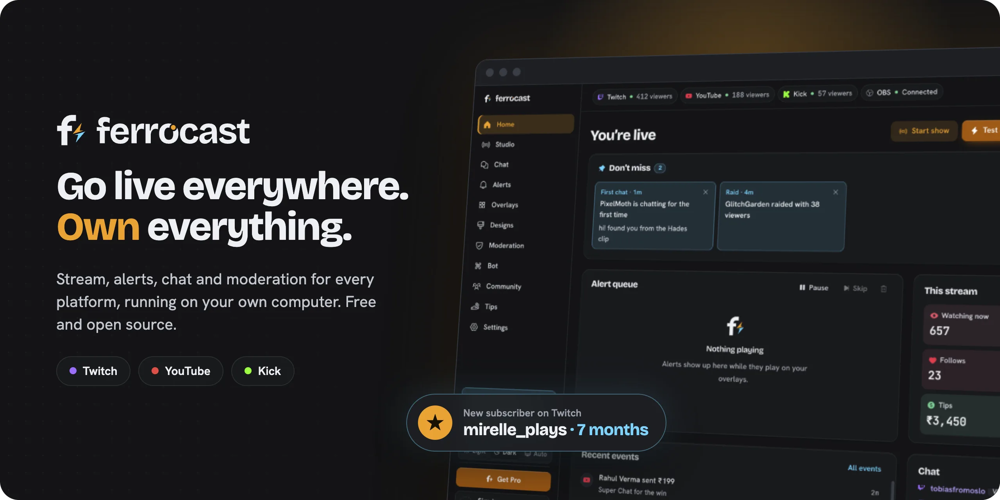
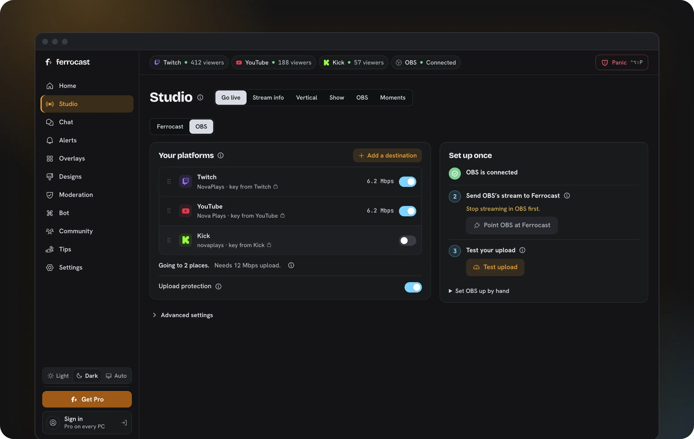
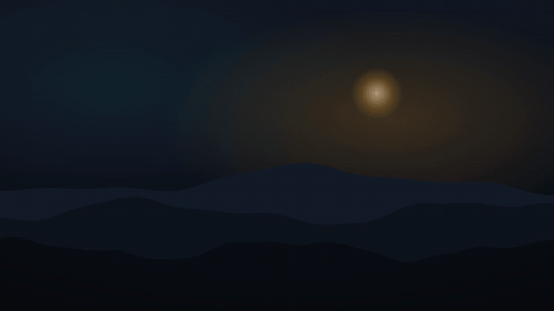
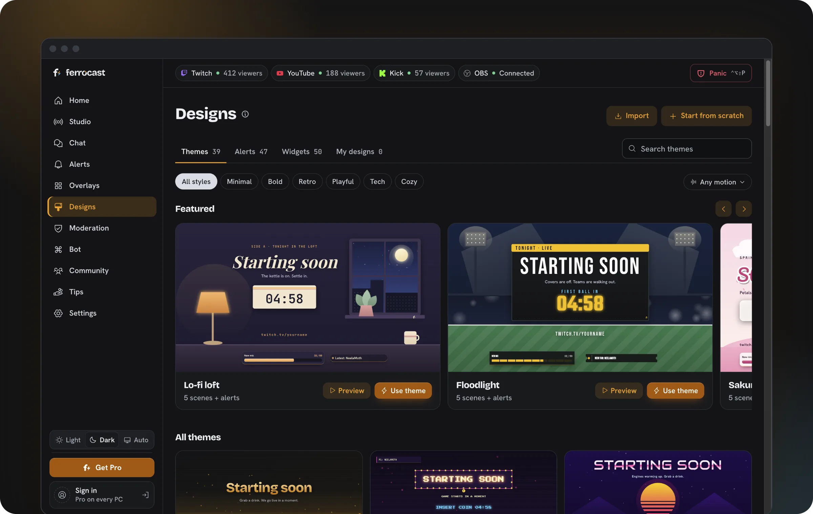
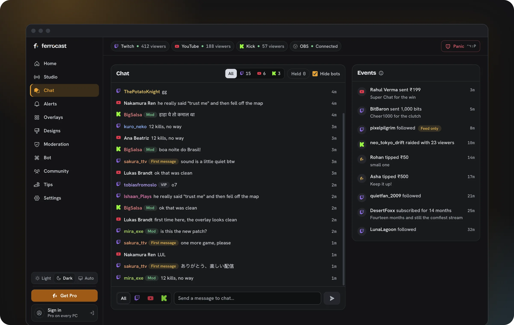
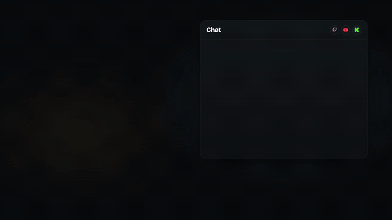

  

  
  
  
  

  <b>Stream, alerts, chat and moderation for Twitch, YouTube and Kick.</b> 
  One free app on your own computer. No cloud to rent, nothing to lose if a server goes away.

  <a href="https://github.com/ArshPunisher/ferrocast/releases/latest"><b>Download</b></a>
  &nbsp;&nbsp;|&nbsp;&nbsp;
  <a href="https://ferrocast.clearcraftlabs.com"><b>Website</b></a>
  &nbsp;&nbsp;|&nbsp;&nbsp;
  <a href="CHANGELOG.md"><b>What's new</b></a>

 

## Go live everywhere at once

Press one button and your stream goes to Twitch, YouTube and Kick together, wide and vertical at the same time. Your title, thumbnail and description go to every platform in one go. Use the built-in Studio, or keep OBS and point it at Ferrocast.

## Alerts that look like yours

Themes, alerts and widgets that play the real thing, ready for OBS or the built-in Studio. Use one as it is, or duplicate it and make it your own.

<table>
  <tr>
    <td width="50%"></td>
    <td width="50%"></td>
  </tr>
</table>

## All your chats, one ban button

Twitch, YouTube and Kick chat in one feed. Ban a spammer once and they are gone from all three. One panic button locks chat everywhere during a hate raid.

<table>
  <tr>
    <td width="50%"></td>
    <td width="50%"></td>
  </tr>
</table>

## Built in, no plugins

<table>
  <tr><td width="26%"><b>Show styles</b></td><td>Just go live, or a countdown and starting scene first. Ending your stream runs the ending.</td></tr>
  <tr><td width="26%"><b>Live captions</b></td><td>On screen as you talk, in many languages, made on your computer.</td></tr>
  <tr><td width="26%"><b>Voice control</b></td><td>Say "clip that", "brb", "switch to" a scene, or start a recording.</td></tr>
  <tr><td width="26%"><b>Clips</b></td><td>Subtitled, with vertical copies ready for Shorts and Reels.</td></tr>
  <tr><td width="26%"><b>Follow my face</b></td><td>The vertical stream keeps you, or the action, in the middle.</td></tr>
  <tr><td width="26%"><b>A scene per game</b></td><td>Open a game and its scene comes up on its own.</td></tr>
  <tr><td width="26%"><b>Ready check</b></td><td>Your mic, cameras, captures and disk are checked when the Studio starts, and it recovers if it crashes.</td></tr>
  <tr><td width="26%"><b>Your phone</b></td><td>Open the same dashboard on your phone, over your Wi-Fi or with a free account.</td></tr>
  <tr><td width="26%"><b>Tips, bot, goals</b></td><td>A tip page, chat commands, points and goals, all yours to export.</td></tr>
</table>

Captions, voice control and follow my face need a Mac for now.

## Why Ferrocast

- **You own your setup.** Overlays, sounds, commands, points and tip history live on your machine. One click exports all of it.
- **Light while you game.** The engine is Rust. The window closes to the tray, and overlays are plain HTML.
- **Few clicks.** Sign in, pick a look, press Go live.
- **Free and open.** GPL-3.0. You don't need a Ferrocast account to stream.

## What's in this repo

This repo holds the engine, the local server, the desktop app and the small relay server. The dashboard, overlays and website live in [`ferrocast-web`](https://github.com/ArshPunisher/ferrocast-web).

| Path | What it is |
|---|---|
| `crates/core` | Events, dedupe, alert queue, templates, filters, commands. Pure Rust, no I/O. |
| `crates/engine` | Wires adapters, the bot, moderation and alerts together. |
| `crates/studio` | The built-in Studio: OBS's libobs and its plugins, loaded at runtime. |
| `crates/golive` | Go live everywhere: a local ingest and one forwarder per platform, no re-encode. |
| `crates/twitch`, `crates/youtube`, `crates/kick` | One adapter per platform. |
| `crates/obs` | OBS WebSocket v5 control. |
| `crates/server` | The local HTTP + WebSocket server for overlays and the dashboard. |
| `crates/store`, `crates/secrets` | SQLite storage, and tokens kept out of the database. |
| `crates/relay` | The hosted relay: Kick webhooks, tip payments, sign-in broker. |
| `apps/desktop` | The Tauri 2 desktop app (tray and one window). |
| `apps/headless` | The engine without a window, for servers and spare PCs. |

## Licence

GPL-3.0-or-later. See [LICENSE](LICENSE). "Ferrocast" is a trademark of ClearCraft Labs; forks must use a different name.

Contributions are signed off with the [Developer Certificate of Origin](https://developercertificate.org/) (`git commit -s`). There is no CLA, so the licence can never be taken away from contributors.
